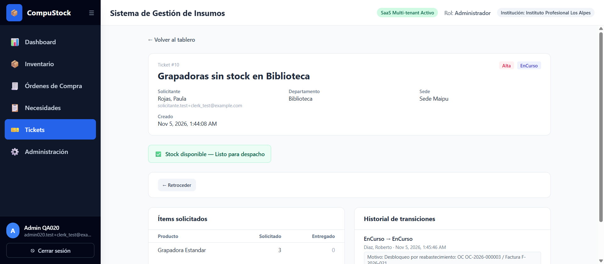
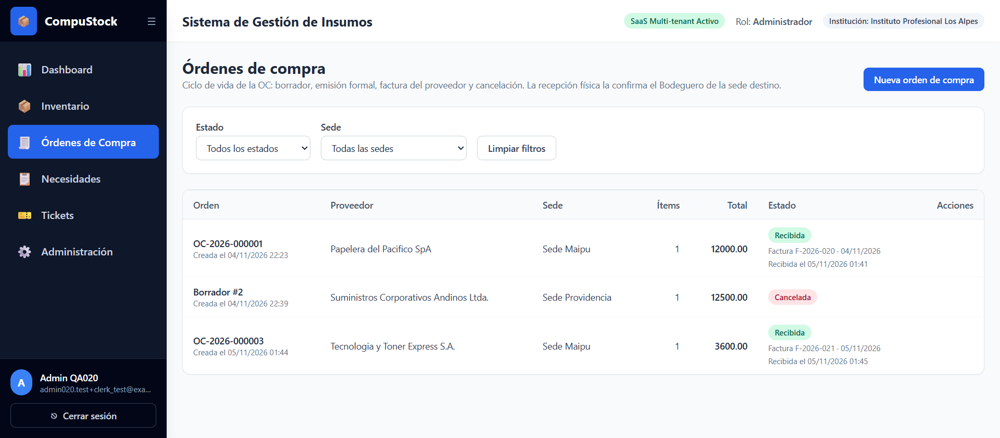
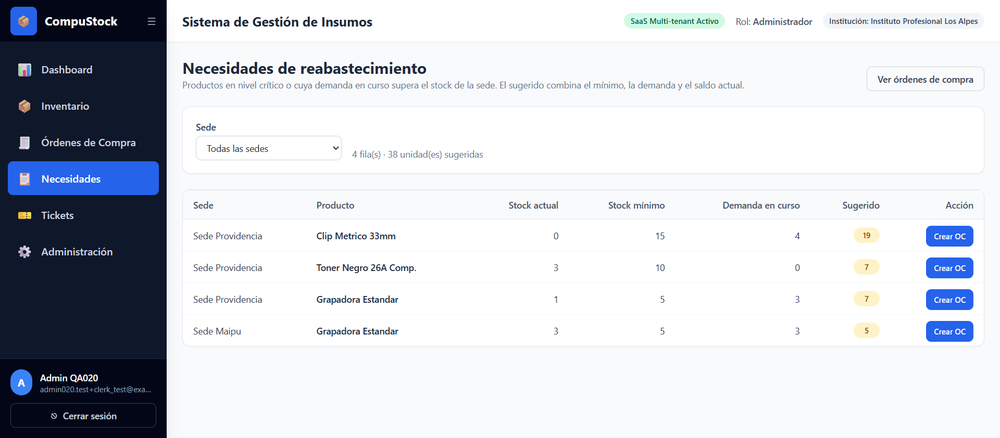

# Feature 020 — Evidencia del recorrido funcional en 4200 y humo en 8080

Cierre de la Feature 020 (reabastecimiento externo y compras). El recorrido se
hizo contra PostgreSQL real (`apt_erp`, 26 tablas de `control`, 23 por tenant,
versión `020.1`) con sesiones Clerk reales y escritura persistida. No se
transcriben tokens ni claves.

Fecha del recorrido: **04–05/Nov/2026** (hora local). Entorno: `docker compose`
con `compustock_db`, `compustock_backend` y `compustock_frontend`; dev server de
Angular en 4200 y build de producción en 8080.

## 1. Suites y contrato

| Verificación | Resultado |
|---|---|
| `pytest` completa con `POSTGRES_TEST_URL` (SQLite + gated PostgreSQL 16) | **1533 passed**, 18 warnings, 0 failed |
| Gated PostgreSQL 020 (`test_compras_postgres_020.py`) | **6/6** |
| Endpoints HTTP 020 (`test_compras_endpoints_020.py`) | **26/26** |
| `ng test --watch=false --browsers=ChromeHeadless` | **518/518 SUCCESS** |
| `ng build` | limpio, sin avisos de presupuesto (`main-DYJHWLAX.js`) |
| `/openapi.json` | 8 rutas / **10 operaciones** de compras; 72 operaciones protegidas por matriz |

## 2. Cuentas del recorrido

| Rol | Cuenta | Ámbito |
|---|---|---|
| Administrador | `admin020.test+clerk_test@example.com` (usuario 13, INST-001) | todas las sedes de la institución |
| Bodeguero | `bodeguero.test+clerk_test@example.com` (Roberto Díaz, usuario 12) | Sede Maipú |
| Solicitante | `solicitante.test+clerk_test@example.com` (Paula Rojas, usuario 11) | Departamento Biblioteca → Sede Maipú |

El código de prueba de Clerk (`424242`) se usó solo en el formulario del
navegador. La cuenta de Administrador se aprovisionó para el recorrido porque la
semilla no incluye un Administrador `+clerk_test` (hallazgo ya registrado en
`MEMORY.md`); su fila vive en `tenant_inst_001_038aa2a9.usuario` y en
`control.mapa_usuario_esquema`, igual que cualquier usuario de negocio.

## 3. Recorrido funcional en 4200

### 3.1 Necesidades (AC-1)

`/compras/necesidades` lista por sede y producto con stock actual, mínimo,
demanda de tickets y cantidad sugerida. La fila de Sede Maipú / Rotulador
Marcador ofreció «Crear OC» con `sede_id=2&producto_id=9&cantidad=6`.

### 3.2 Alta y edición de la OC en borrador (AC-3)

Desde esa sugerencia se abrió `/compras/nueva` con sede y producto precargados.
Se eligió el proveedor «Papelera del Pacífico SpA» y cantidad **8** a **$1.500**;
la OC se creó como `Borrador #1`. Antes de emitir se editó la cantidad de 6 a 8
en `/compras/1/editar`, guardando desde el listado institucional (no existe
`GET /compras/ordenes/{id}`) y con el formulario bloqueado fuera de `Borrador`.

### 3.3 Emisión (AC-4)

«Emitir orden 1» asignó **`OC-2026-000001`** y mostró «Orden OC-2026-000001
emitida». El número se deriva del identity (`OC-{AÑO}-{id:06d}`), no de
`MAX+1`.

### 3.4 Factura como llave de recepción (AC-5)

«Registrar factura» abrió el modal con número, fecha de emisión, monto y
observaciones. Se registró **`F-2026-020`** por **$12.000**; la OC pasó a
`Facturada` y el listado mostró «Factura F-2026-020 · 04/11/2026». El mismo
`PUT` sirve para corregir la factura mientras la OC siga `Facturada`.

### 3.5 Cancelación con motivo (AC-12)

Se creó una segunda OC (`Borrador #2`, Suministros Corporativos Andinos,
Sede Providencia, Papel Premium A4, 5 × $2.500) y se canceló. Sin motivo, el
formulario mostró «El motivo de cancelación es obligatorio»; con el motivo
«Proveedor sin stock del producto solicitado» la orden quedó `Cancelada`.

### 3.6 Recepción del Bodeguero (AC-6, AC-7, AC-8, AC-9)

Con la sesión del Bodeguero de Sede Maipú, el menú solo ofreció «Recepción de
Compras» (`/compras/recepcion`). La vista mostró únicamente la OC `Facturada`
de su sede, con factura, monto e ítems. La confirmación en modal informó «Orden
de compra recepcionada exitosamente» y la lista quedó vacía.

Contraste en base:

| Dato | Antes | Después |
|---|---|---|
| `stock_sede` Sede Maipú / Rotulador Marcador (producto 9) | 6 | **14** |
| `orden_compra` 1 | `Facturada` | **`Recibida`** con `fecha_recepcion` |
| `movimiento_inventario` | — | filas `ENTRADA` por la recepción |

### 3.7 Desbloqueo de tickets y aviso al Solicitante (AC-10, AC-11)

Para acreditar el desbloqueo se creó, como Solicitante, el ticket **#10**
«Grapadoras sin stock en Biblioteca» (Grapadora Estándar, 3 unidades, `Alta`,
`EnCurso`) cuando Sede Maipú no tenía saldo de ese producto: el detalle **no**
mostró badge.

Luego, como Administrador, se creó y facturó la OC **`OC-2026-000003`**
(Tecnología y Toner Express, Sede Maipú, Grapadora Estándar 3 × $1.200,
factura **`F-2026-021`**) y el Bodeguero la recepcionó. La interfaz informó
«Se desbloquearon 1 ticket(s): Grapadoras sin stock en Biblioteca» y el stock
pasó de **sin fila** a **3** en `stock_sede`.

La auditoría del desbloqueo quedó en `historial_transicion_ticket`:

| id | ticket | origen | destino | actor | motivo |
|---|---|---|---|---|---|
| 3 | 10 | `EnCurso` | `EnCurso` | usuario 12 (Bodeguero) | `Desbloqueo por reabastecimiento: OC OC-2026-000003 / Factura F-2026-021` |

El detalle del ticket #10, ya con saldo, mostró el badge **«Stock disponible —
Listo para despacho»** y el historial «EnCurso → EnCurso». El ticket #9
(Rotulador Marcador, 4 unidades), creado después de la recepción de
`OC-2026-000001`, nació ya cubierto: su detalle mostró el badge desde el
primer render porque el saldo de Sede Maipú había subido de 6 a 14.

### 3.8 Roles y navegación (AC-13)

| Sesión | Enlaces de compras visibles |
|---|---|
| Administrador | «Órdenes de Compra» y «Necesidades» |
| Bodeguero | «Recepción de Compras» únicamente |
| Solicitante | ninguno |

El segmento `/compras` usa `ROLES_COMPRAS` (Administrador + Bodeguero) y cada
vista hija exige su rol con `RolGuard`; un acceso directo fuera de rol cae en
`/acceso-denegado`. Los 403 de matriz, capacidad y sede se cubren en
`test_compras_endpoints_020.py` (roles no autorizados, Superadmin, capacidad
apagada, Bodeguero sin sede).

## 4. Humo en 8080

Se reconstruyó la imagen (`docker compose -f docker-compose.yml build
frontend` + `up -d frontend`; bundle **`main-DYJHWLAX.js`**, idéntico al de T9,
sin deriva de código) y se recorrió el build de producción:

| Comprobación | Resultado |
|---|---|
| Login de Administrador y menú | «Órdenes de Compra» y «Necesidades» presentes |
| `/compras` | OC-2026-000001 `Recibida` con F-2026-020, Borrador #2 `Cancelada`, OC-2026-000003 `Recibida` con F-2026-021 |
| `/compras/necesidades` (deep link, recarga completa) | tabla renderizada; `try_files` de nginx sirve la ruta Angular |
| Login de Solicitante | menú sin enlaces de compras |

## 5. Qué no demuestra esta evidencia

- La concurrencia de la recepción (segundo intento 409) se acredita en el gated
  PostgreSQL (`test_compras_postgres_020.py`), no en el recorrido.
- La ausencia de réplica del proveedor creado por el Superadmin solo se puede
  acreditar en PostgreSQL (en SQLite `control` y tenant comparten tabla física);
  está cubierta por el gated.
- La baja/reactivación de proveedores y la interfaz dedicada del Superadmin
  quedan fuera de alcance por spec (§9.1 y §9.16).
